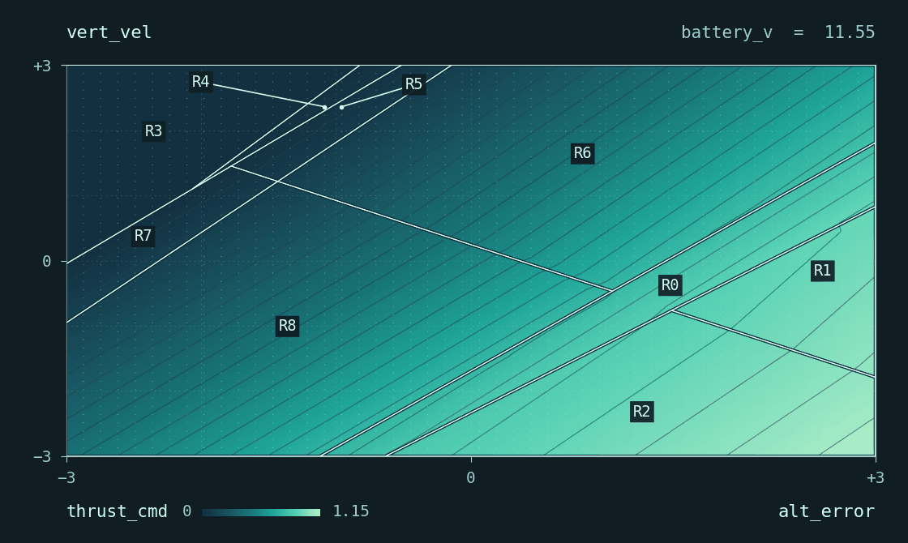

# GlassBox

GlassBox decompiles a small feed-forward ONNX network into a readable, branch-based program. Give it a bounded input domain and it fits symbolic expressions for each operating region, searches for counterexamples and emits C99, Rust and standalone Python. The generated program can run without an ML runtime.

[Open GlassBox Studio](https://dafenxz0.github.io/glassbox/studio/) · [Project website](https://dafenxz0.github.io/glassbox/) · [Benchmark ledger](docs/BENCHMARKS.md)

[](https://dafenxz0.github.io/glassbox/studio/?model=drone_altitude_pid)

## Try a real proof

The repository includes everything needed to replay the drone example, including the ONNX weights, typed program, generated source and certificate. Use Python 3.11+ from a source checkout.

```sh
git clone https://github.com/Dafenxz0/glassbox.git
cd glassbox
python -m venv .venv
source .venv/bin/activate
python -m pip install -e .
glassbox verify bundles/drone_altitude_pid.gbundle --timeout 30
```

On Windows PowerShell, activate the environment with `.\.venv\Scripts\Activate.ps1`. The replay checks seven file digests, compares the bundled Python source against the installed emitter, evaluates the ONNX model against the program and runs Z3. A successful replay of the shipped example prints `VERIFIED_REPRODUCED` and `PROVEN_REAL_GLOBAL`. If a longer replay resolves an earlier timeout or unknown result, the CLI reports `REPLAY_RESOLVED` and displays both statuses. The explicit `--no-smt` option runs artifact and numerical checks and reports `ARTIFACTS_CHECKED`.

## Explore in Studio

The hosted Studio opens four recorded executions without installing Python. Select a model, inspect C99 or Rust, click a decision region, open its certificate or download its source. Each model has a shareable link.

For uploads, custom slices and fresh verification runs, start the local engine from the checkout.

```sh
glassbox studio
```

Open [local Studio](http://127.0.0.1:8765/studio/). Upload a supported ONNX MLP and supply a `DomainSpec` with feature names, lower and upper bounds, output names and task type. Local decompilation streams iterations as they finish. See the [drone model metadata](models/drone_altitude_pid.meta.json) for a concrete domain.

## What the saved runs establish

| Run | Task | Regions | Sample agreement | Final certificate |
| --- | --- | ---: | ---: | --- |
| [Drone altitude](https://dafenxz0.github.io/glassbox/studio/?model=drone_altitude_pid) | Regression | 9 | 100.00% | `PROVEN_REAL_GLOBAL` |
| [CartPole](https://dafenxz0.github.io/glassbox/studio/?model=cartpole_policy) | Classification | 3 | 99.98% | `COUNTEREXAMPLE_FOUND` |
| [Reactor guard](https://dafenxz0.github.io/glassbox/studio/?model=reactor_safety_guard) | Classification | 30 | 92.86% | `COUNTEREXAMPLE_FOUND` |
| [Nonlinear actuator](https://dafenxz0.github.io/glassbox/studio/?model=nonlinear_actuator) | Regression | 12 | 99.67% | `COUNTEREXAMPLE_FOUND` |

For the saved drone program, Z3 found the violation query unsatisfiable on all nine leaves. Under exact real arithmetic its absolute output error is at most **0.05** across the declared input box. Across **5,662 measured inputs**, the largest observed floating-point difference was **0.034540**. The four counterexamples in the run came from earlier iterations and were repaired.

For classification, a margin-conditioned proof covers inputs meeting the specified score margin. Smooth activations use bounded empirical falsification. A timeout or an unknown solver result leaves the proof open. The [verification specification](docs/CEGIS_AND_SMT.md) describes the statuses, including the legacy `PROVEN_SMT` label.

## Generate a new program

```sh
glassbox zoo list
glassbox inspect models/drone_altitude_pid.onnx
glassbox decompile models/drone_altitude_pid.onnx --out out --targets c,rust,python,ir --eps 0.05 --bundle
glassbox verify out/drone_altitude_pid.gbundle --timeout 30
```

A fresh run uses the CLI configuration and its own solver budget. Inspect its certificate for the outcome. The output directory includes the C source and header, Rust and Python implementations, JSON IR, a Mermaid decision tree and the certificate. Add `--pareto` to compare candidate programs or `--no-bench` to skip runtime timings.

Run the self-tests on the generated code with the relevant toolchains installed.

```sh
gcc -std=c99 -Wall -Wextra -Werror -O3 -DGLASSBOX_MAIN out/drone_altitude_pid.c -lm -o out/test_c
./out/test_c
rustc --test -D warnings out/drone_altitude_pid.rs -o out/test_rust
./out/test_rust
python out/drone_altitude_pid.py
```

## Develop

```sh
python -m pip install -e ".[dev]"
ruff check src tests scripts
pytest -q
python scripts/build_web.py
```

The static build assembles the landing page, Studio and recorded runs into `dist/`. All fonts, charts and demo data are served locally. The Python service also serves the web interface directly from the checkout.

[Architecture](docs/ARCHITECTURE.md) · [Benchmarks and methodology](docs/BENCHMARKS.md) · [Contributing](CONTRIBUTING.md) · [Security](SECURITY.md) · [Changelog](CHANGELOG.md) · [MIT license](LICENSE)
