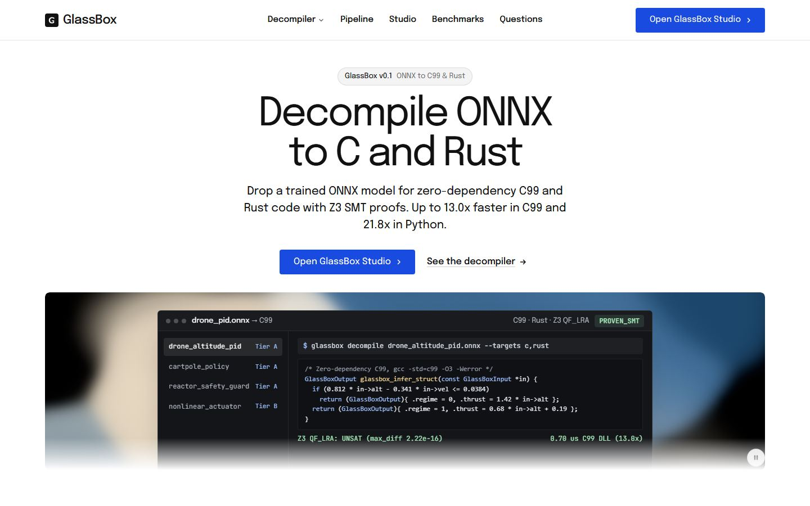
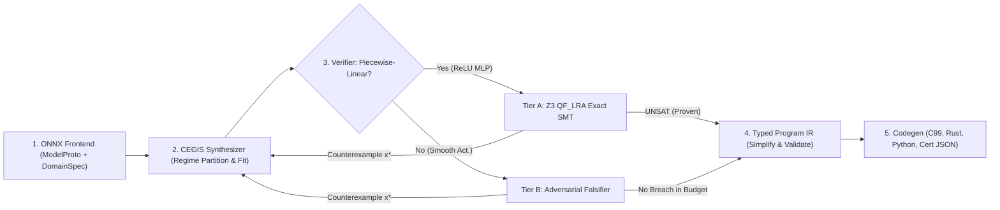

# GlassBox

> **Drop a black-box ONNX neural network. Get back readable, zero-dependency C99 & Rust code — with Z3 counterexample proofs.**

[](pyproject.toml)
[](LICENSE)
[](docs/ARCHITECTURE.md)
[](docs/CEGIS_AND_SMT.md)

GlassBox is a **neural-network-to-program CEGIS decompiler**. Given a bounded-domain `.onnx` model and an input `DomainSpec`, it partitions the input space into interpretable operating regimes, synthesizes closed-form symbolic expressions per regime, verifies equivalence against the original network using Z3 SMT (`QF_LRA`) or adversarial falsification, and emits standalone C99, `no_std` Rust, and zero-dependency Python alongside a SHA-256-bound `VerificationCertificate`.



---

## Why GlassBox?

Opaque neural weights are difficult to audit, certify, or embed in tight control loops. GlassBox lowers bounded-domain neural policies into explicit `if / else` control logic with zero ML runtime dependencies:

- **Readable symbolic code**: Every operating regime becomes a commented branch with linear or degree-2 polynomial expressions over named physical inputs (`alt_error`, `vert_vel`, `battery_v`).
- **Honest two-tier verification**: Piecewise-linear ReLU MLPs receive exact Z3 SMT checking (`PROVEN_SMT` on `UNSAT`, or concrete `Counterexample` witnesses); smooth networks (`Tanh`, `Sigmoid`) receive bounded adversarial falsification without ever overclaiming a formal proof.
- **Native compiler-clean output**: Generated C99 compiles cleanly under `-Wall -Wextra -Werror -std=c99 -O3 -lm` and generated Rust compiles cleanly under `rustc --test -D warnings` with `#![cfg_attr(not(test), no_std)]`.
- **Interactive Studio & CLI**: Inspect ONNX graphs, stream CEGIS iterations via SSE, explore 2D input-space error heatmaps, and download verified artifacts from the CLI or browser Studio.

---

## Pipeline Architecture



See [`docs/ARCHITECTURE.md`](docs/ARCHITECTURE.md) for module-level details and [`docs/CEGIS_AND_SMT.md`](docs/CEGIS_AND_SMT.md) for the exact `QF_LRA` SMT formulation.

---

## Real Decompiled C99 Output (`drone_altitude_pid`)

Below is an actual excerpt emitted by GlassBox for `models/drone_altitude_pid.onnx` (`3 -> 12 -> 10 -> 1` ReLU MLP), certified **`PROVEN_SMT`** (`UNSAT` under Z3 within `tolerance_eps = 0.05`, `max_abs_error = 0.04768`, `8` regimes, `119` AST nodes):

```c
/* Auto-generated C99 implementation by GlassBox for drone_altitude_pid_decompiled */
typedef struct {
    double alt_error;
    double vert_vel;
    double battery_v;
} GlassBoxInput;

typedef struct {
    double thrust_cmd;
    int regime_id;
    int class_id;
} GlassBoxOutput;

static void glassbox_eval_core(
    const double* x,
    double* out_values,
    int* out_regime,
    int* out_class
) {
    const double alt_error = x[0];
    const double vert_vel = x[1];
    const double battery_v = x[2];
    int regime_id = 0;
    int class_id = -1;

    if (0.78626198716757012 * alt_error - 0.58911751778751953 * vert_vel - 0.18636694388001229 * battery_v + 1.0607983582346816 <= 0.0) {
        if (0.77954668111338821 * alt_error - 0.59388854346885767 * vert_vel - 0.19900595443739949 * battery_v + 4.5441069984142946 <= 0.0) {
            /* Regime 0: regime_0_alt_error_lo (samples=223, local_err=0.00525597) */
            out_values[0] = ((((0.0041797999696996362 * alt_error) - (0.0025951893181324895 * vert_vel)) + (0.00014341169614881229 * battery_v)) + 0.024212879522219496);
            regime_id = 0;
            class_id = -1;
        } else {
            /* ... remaining 7 SMT-proven regimes ... */
```

---

## Measured Zoo Verification & Benchmarks

All values below come directly from [`studio/demo-data/benchmarks_summary.json`](studio/demo-data/benchmarks_summary.json) (`n_warmup = 100`, `n_iters = 2000`, `batch = 1`, Windows x86_64 CPU, native C99 DLL compiled via `ziglang cc -O3 -shared -std=c99` and measured via `ctypes`):

| Model | Task (`Dims`) | Params | Verification Status | Agreement | Max Abs Error | ORT `p50` | Python `p50` (Speedup) | C99 DLL `p50` (Speedup) | C99 `max_diff` vs IR |
| :--- | :--- | ---: | :--- | ---: | ---: | ---: | ---: | ---: | ---: |
| [`drone_altitude_pid`](models/drone_altitude_pid.meta.json) | Regression (`3 -> 1`) | 189 | **`PROVEN_SMT`** (`8` regimes) | 100.00% | `0.04768` | `9.10 us` | `0.50 us` (`18.20x`) | `0.70 us` (`13.00x`) | `2.22e-16` |
| [`cartpole_policy`](models/cartpole_policy.meta.json) | Classification (`4 -> 2`) | 242 | `COUNTEREXAMPLE_FOUND` (`25` regimes) | 99.11% | `10.4819` | `6.30 us` | `0.50 us` (`12.60x`) | `0.50 us` (`12.60x`) | `3.55e-15` |
| [`reactor_safety_guard`](models/reactor_safety_guard.meta.json) | Classification (`4 -> 3`) | 289 | `COUNTEREXAMPLE_FOUND` (`21` regimes) | 89.98% | `27.6756` | `6.40 us` | `0.60 us` (`10.67x`) | `0.50 us` (`12.80x`) | `2.84e-14` |
| [`nonlinear_actuator`](models/nonlinear_actuator.meta.json) | Regression (`3 -> 2`) | 746 | `COUNTEREXAMPLE_FOUND` (Tier B, `8` regimes) | 99.60% | `0.12995` | `8.70 us` | `0.40 us` (`21.75x`) | `0.70 us` (`12.43x`) | `4.44e-16` |

See [`docs/BENCHMARKS.md`](docs/BENCHMARKS.md) for full `p50`/`p95`/`p99` latencies, throughput, artifact sizes, and PyTorch eager comparisons.

---

## Quickstart

### 1. Install

Requires Python 3.11+.

```bash
python -m venv .venv
# Linux / macOS:
source .venv/bin/activate
# Windows (PowerShell):
.\.venv\Scripts\Activate.ps1

pip install -e ".[dev]"
```

### 2. CLI Workflow

```bash
# List bundled benchmark zoo models
glassbox zoo list

# Inspect ONNX layers, domain bounds, and piecewise-linear eligibility
glassbox inspect models/drone_altitude_pid.onnx

# Decompile to C99, Rust, Python, IR JSON, and Mermaid + run Z3 SMT & benchmarks
glassbox decompile models/drone_altitude_pid.onnx --out /tmp/gb_out --targets c,rust,python,ir --eps 0.05

# Compile and run the generated C99 golden-vector self-test
gcc -Wall -Wextra -Werror -std=c99 -O3 -DGLASSBOX_MAIN /tmp/gb_out/drone_altitude_pid.c -lm -o /tmp/gb_test
/tmp/gb_test

# Compile and run the generated no_std Rust unit tests
rustc --test -D warnings /tmp/gb_out/drone_altitude_pid.rs -o /tmp/gb_rs_test
/tmp/gb_rs_test
```

### 3. Launch GlassBox Studio

```bash
glassbox studio --host 127.0.0.1 --port 8765
```

Open `http://127.0.0.1:8765/studio/` for the interactive 3-column workbench (or `http://127.0.0.1:8765/` for the product landing page). The Studio also runs in **Static Demo Mode** directly from `studio/demo-data/` when no API server is attached.

---

## Verification Tiers

GlassBox uses four explicit `VerificationStatus` values in every `VerificationCertificate`:

| Status | Tier | Meaning |
| :--- | :--- | :--- |
| **`PROVEN_SMT`** | Tier A (ReLU MLPs) | Z3 `QF_LRA` returned `UNSAT` over every input inside the declared `DomainSpec` hyperrectangle (`||NN(x) - P(x)||_inf <= eps` or identical argmax class). |
| **`BOUNDED_EMPIRICAL`** | Tier B (Smooth Nets) | Quasi-random sampling + multi-start Nelder-Mead falsification found zero breaches within budget. Explicitly **not** a universal proof. |
| **`COUNTEREXAMPLE_FOUND`** | Tier A or Tier B | A concrete witness `x*` violating `eps` or class agreement remains after the CEGIS iteration budget. |
| **`UNVERIFIED`** | None | Verification was skipped or did not complete cleanly. |

---

## Development & Documentation

- [Architecture Overview](docs/ARCHITECTURE.md)
- [CEGIS & SMT Formalization](docs/CEGIS_AND_SMT.md)
- [Benchmarks & Verification Ledger](docs/BENCHMARKS.md)
- [Contributing Guide](CONTRIBUTING.md)
- [Security & Safety Policy](SECURITY.md)
- [Changelog](CHANGELOG.md)
- [MIT License](LICENSE)

Run tests and linting locally:

```bash
ruff check src tests scripts
pytest -v
```
