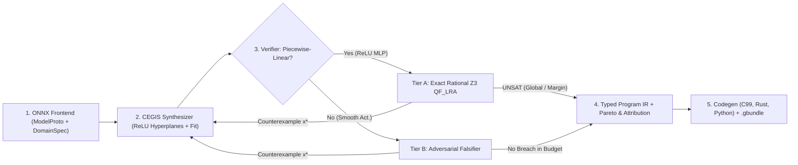

# GlassBox Architecture

GlassBox is an **executable, auditable neural interpretability & CEGIS decompilation engine**. Given a bounded-domain `.onnx` model and an input `DomainSpec`, it synthesizes a readable, branch-structured symbolic program (`DecompiledProgram`), verifies equivalence against the original neural network, and emits zero-dependency C99, `no_std` Rust, and Python implementations alongside a reproducible artifact bundle (`.gbundle`) and `VerificationCertificate`.

## Positioning: How GlassBox Differs from Neural Verifiers & Compilers

| Tool Category | Representative Tools | Primary Goal | How GlassBox Differs |
| :--- | :--- | :--- | :--- |
| **Neural Property Verifiers** | Marabou, α,β-CROWN, ERAN | Prove input-output safety bounds on the original black-box weight matrices | GlassBox **replaces** the opaque weight matrix on the bounded operating domain with a compact, human-auditable `if / else` symbolic program and proves equivalence between the network and the readable code. |
| **Deep Learning Graph Compilers** | ONNX-MLIR, TVM, XLA, Glow | Lower tensor graphs into hardware-optimized loop nests / SIMD kernels executing the exact matrix multiplications | Tensor compilers preserve opaque dense layer algebra (`Gemm` loops). GlassBox performs **semantic regime synthesis (CEGIS)**, collapsing multi-layer activation regions into explicit domain-variable linear or polynomial laws with rule-to-neuron attribution. |
| **Heuristic Surrogate Distillers** | CART / Decision-Tree Distillation, LIME/SHAP | Fit local or global interpretable approximations without formal equivalence checks | GlassBox pairs synthesis with an **exact rational Z3 `QF_LRA` verifier** (Tier A) that actively hunts for counterexamples `x*` across the continuous input domain and feeds them back into the partitioner until `UNSAT` or budget exhaustion. |

---

## 5-Stage Pipeline

### Stage 1: ONNX Frontend & Neuron Attribution (`src/glassbox/loader.py`)
- Parses `.onnx` graphs (`onnx`), computes the model SHA-256 digest and byte size, and extracts `LayerInfo` and exact `DenseLayer` weights (`Gemm`, `MatMul` + `Add`, `Relu`, `Tanh`, `Sigmoid`, `Clip`).
- Classifies the network as piecewise-linear (`is_piecewise_linear = True` when `extract_mlp_layers()` succeeds and all layer activations are in `{"Relu", "Identity"}`).
- Computes deterministic **Rule-to-Neuron Attribution** (`compute_regime_neuron_profiles`) and zero-LLM **Decision Explanations** (`explain_decision`) linking each symbolic regime branch to the exact hidden neurons firing in the ONNX network.

### Stage 2: CEGIS Synthesizer 2.0 (`src/glassbox/regimes.py`, `src/glassbox/synthesizer.py`)
- Extracts operating regimes (`extract_regimes`) using either `oblique_tree` (which includes **exact normalized Layer-1 ReLU neuron hyperplanes** `w_j · x + b_j = 0` alongside sparse axis/PCA/LDA directions) or `activation` sign-pattern clustering.
- Synthesizes closed-form leaf expressions (`synthesize_program`): sparse weighted linear laws (`max_degree = 1`) or BIC-selected quadratic expressions (`max_degree >= 2`) for regression, and per-class linear logit expressions (or pure constant class leaves when 100% pure and margin-separated) for classification.
- Surgically refines failing regimes around counterexamples (`refine_regime_around_counterexamples`) and optionally sweeps regime budgets (`search_pareto_frontier`) to map the complexity-vs-error Pareto frontier.

### Stage 3: Two-Tier Verifier (`src/glassbox/verifier/smt.py`, `src/glassbox/verifier/adversarial.py`)
- **Tier A — Exact Rational SMT (`QF_LRA`)**: Converts IEEE-754 weights, biases, guards, and leaf coefficients to exact Python `fractions.Fraction` and Z3 rationals (`z3.Q`), applies sound outward-rounded `Fraction` Interval Bound Propagation (IBP), and queries Z3 per regime leaf polyhedron:
  - Distinguishes **`PROVEN_REAL_GLOBAL`** (`scope="global"`), **`PROVEN_REAL_MARGIN`** (`scope="margin_conditioned"` when `classification_margin > 0`), **`TIMEOUT`**, **`UNKNOWN`**, and **`COUNTEREXAMPLE_FOUND`**.
- **Tier B — Adversarial Falsification**: For smooth networks (`Tanh`, `Sigmoid`) or rapid empirical auditing, combines 4096-point Sobol sampling, domain corners, guard-boundary probes, and multi-start Nelder-Mead optimization (`BOUNDED_EMPIRICAL` or `COUNTEREXAMPLE_FOUND`).

### Stage 4: Typed Program IR & Two-Tier Assurance (`src/glassbox/ir.py`, `src/glassbox/certificate.py`)
- Represents policies as a self-contained AST (`DecompiledProgram`) supporting `predict`, `predict_classes`, `assign_regime`, `trace_one`, and `ast_node_count`.
- Packages two complementary assurance records inside `VerificationCertificate`:
  1. **`RealArithmeticProof`**: Formal Z3 rational-arithmetic proof metadata (`exact_rationals`, `sound_bounds_only`, `scope`, `z3_version`, `solver_result`, `leaves_proven / leaves_total`, `leaf_proven_map`).
  2. **`NumericalDeploymentAssurance`**: Empirical float32 ONNXRuntime vs. IR agreement and compiled native C99 / Python vs. IR maximum discrepancy.

### Stage 5: Zero-Dependency Codegen, Reproducible Bundles & Surfaces
- **C99 emitter (`src/glassbox/emitters/c_emitter.py`)**: Standalone `.c` / `.h` with `glassbox_infer`, `glassbox_infer_struct`, `glassbox_bench_loop` (pure C tight loop for FFI-free native latency measurement), `-DGLASSBOX_MAIN` golden-vector test runner, and automatic compiler detection (`find_c_compiler`: `gcc` -> `clang` -> `ziglang cc`).
- **Rust emitter (`src/glassbox/emitters/rust_emitter.py`)**: `#![cfg_attr(not(test), no_std)]` module with typed `Input`/`Output` structs, `ClassId` enum, and `#[cfg(test)]` golden-vector tests.
- **Python & IR emitters (`python_emitter.py`, `ir_emitter.py`)**: Zero-dependency Python (`math`, `dataclasses`), canonical `.ir.json`, and valid Mermaid `flowchart TD` decision graphs.
- **Reproducible Bundles (`.gbundle`)**: `write_artifact_bundle` and `verify_artifact_bundle` (`glassbox verify <bundle>`) enable third-party cryptographic hash checking and from-scratch Z3 SMT proof replay.
- **Surfaces**: Typer CLI (`glassbox inspect`, `decompile`, `verify`, `bench`, `studio`, `zoo list`, `zoo train`), FastAPI server (`src/glassbox/server.py`), and GlassBox Studio 2.0 (`studio/`, live on GitHub Pages at [`https://dafenxz0.github.io/glassbox/studio/`](https://dafenxz0.github.io/glassbox/studio/)).
