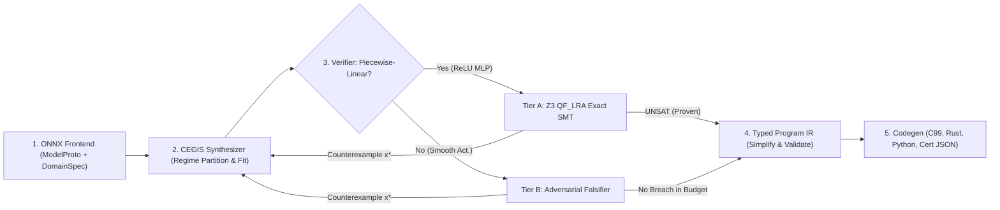

# GlassBox Architecture

GlassBox is a **neural-to-code CEGIS decompiler**. Given a bounded-domain `.onnx` model and an input `DomainSpec`, it synthesizes a readable, branch-structured symbolic program, verifies equivalence against the original neural network, and emits zero-dependency C99, Rust, and Python implementations alongside a machine-readable `VerificationCertificate`.

## 5-Stage Pipeline

### Stage 1: ONNX Frontend & Domain Contract
- Parses the `.onnx` graph (`onnx`), computes the model SHA-256 digest and byte size, and extracts `LayerInfo` records (linear/Gemm/MatMul layers, activations, parameter counts).
- Classifies the network as piecewise-linear (`is_piecewise_linear = True` when all hidden activations are ReLU) or smooth/non-linear.
- Binds a `DomainSpec` declaring `feature_names`, per-dimension `[lower_bounds, upper_bounds]`, `output_names`, and `TaskType` (`classification` or `regression`).

### Stage 2: CEGIS Synthesizer
- Samples initial points inside the `DomainSpec` hyperrectangle and traces activation sign patterns (or local Jacobian/output regimes) through the neural network.
- Groups samples into polyhedral/linear regimes and fits exact or least-squares affine rules (`W_r x + b_r`) per regime, building a decision tree / conditional `ProgramIR`.
- On each Counterexample-Guided Inductive Synthesis (CEGIS) iteration, counterexamples returned by Stage 3 are added to the active dataset to split inaccurate regimes or synthesize exact linear pieces until convergence or iteration budget exhaustion.

### Stage 3: Two-Tier Verifier
- **Tier A — Exact SMT (`QF_LRA`)**: For ReLU MLPs, encodes both the neural network (via Big-M / exact ReLU constraints) and the candidate `ProgramIR` in Z3's Quantifier-Free Linear Real Arithmetic logic. Queries whether any `x` in the domain violates `||NN(x) - P(x)||_inf > epsilon` (or argmax class mismatch for classification).
  - `SAT` returns a concrete `Counterexample` fed back to Stage 2.
  - `UNSAT` certifies `VerificationStatus.PROVEN_SMT`.
- **Tier B — Adversarial Falsification**: For smooth networks (e.g., `Tanh`, `Sigmoid`, `GELU`), combines low-discrepancy sampling with gradient-based / local search to seek error maxima above `epsilon`.
  - If a breach is found, returns a `Counterexample` (`COUNTEREXAMPLE_FOUND`) to Stage 2.
  - If the falsification budget completes without breach, labels the result `VerificationStatus.BOUNDED_EMPIRICAL` (explicitly distinguished from a formal proof).

### Stage 4: Typed Program IR & Simplifier
- Represents the synthesized policy in an explicit AST (`ProgramIR`) consisting of typed input bindings, linear expressions, threshold/linear predicates, `IfThenElse` branches, and constant/affine output leaves.
- Prunes dead branches, folds trivial arithmetic, and tracks AST node counts and active regime counts for every CEGIS step.

### Stage 5: Zero-Dependency Codegen & Surfaces
- **C99 emitter**: Produces standalone `.c` / `.h` code compiling cleanly under `gcc -std=c99 -Wall -Wextra -Werror -O3 -lm` with an optional `-DGLASSBOX_MAIN` smoke harness.
- **Rust emitter**: Produces standalone `.rs` code with inline `#[cfg(test)]` tests compiling cleanly under `rustc --test -D warnings`.
- **Python emitter**: Produces readable pure-Python control logic with zero ML runtime dependencies.
- **Certificate emitter**: Outputs a versioned JSON `VerificationCertificate` capturing model SHA-256, domain bounds, CEGIS iteration trace, final `VerificationStatus`, and measured runtime benchmarks.
- **Surfaces**: Exposed through the `glassbox` Typer CLI (`inspect`, `decompile`, `bench`, `studio`, `zoo list`, `zoo train`) and the FastAPI + browser GlassBox Studio (`src/glassbox/server.py`, `studio/`).
